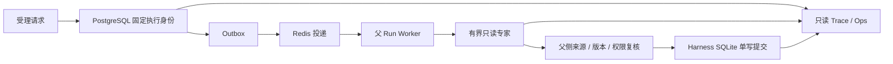

# EduAgent 技术面试证据索引

核对日期：2026-11-01。当前索引覆盖已验收的 M1、M2、M3 Tasks1–7，
以及 `0b2247b` 的演示兼容修复。Task8 首次独立规格审查复现四个缺口，
修复冻结于 `a4691bf`：定向 457 / 完整后端 1400 项通过，均无失败、错误或跳过。
新的独立规格复审通过，但代码审查复现权限观测与晋级事务之间的并发漏洞，
并发修复冻结于 `4c9b204`：定向 469 / 完整后端 1412 项通过，
父侧已核验 XML 与源码摘要；新的独立规格与代码验收尚待完成。
Policies 页面和完整灰度演练尚待验收；最终交付时需重新核对本页与实际代码、运行证据。

项目适合从三个问题展开：如何可靠执行 Agent，如何保护学习证据，
如何判断一项算法修改是否值得发布。每个问题都应能定位到机制、
失败用例与可复现结果。

## 已有机制与证据

| 面试问题 | 机制与实现入口 | 可检查证据 | 适用边界 |
| --- | --- | --- | --- |
| Worker 崩溃后谁有提交权？ | PostgreSQL Run/Lease、单调 fencing token、Outbox；[repository](../../python/core/distributed/repository.py) | [Run Plane 故障矩阵](distributed-run-plane.md)、[真实等锁回归](../../python/tests/distributed/test_lease_lock_time.py) | Redis 只投递；外部模型副作用不承诺 exactly-once |
| 专家如何并行计算而不乱写学生状态？ | 冻结快照、独立专家租约、双重 fencing、父侧结果复核；[expert_repository](../../python/core/distributed/expert_repository.py) | [Expert Plane](bounded-expert-plane.md)、[强杀接管原始 JSON](../superpowers/reports/demo-startup-final.json) | 父侧 Harness SQLite 仍单写；accepted draft 不等于公开交付 |
| 超时与取消是否真正释放资源？ | 有界预算、deadline、取消 drain 后释放存储锁 | [并发边界](harness-concurrency-20261029.md)、[Shadow 取消与锁审查](../superpowers/reports/2026-11-01-m3-task7-shadow.md) | 不响应取消的内部任务会持续持锁，不能声称强制终止 |
| 获得提示后答对能否算掌握？ | 首次独立作答与受助证据分离，回复/测验/学习状态同一 SQLite 事务 | [Tutor Harness 回归](../../python/tests/test_tutor_harness.py)、[L05 原始分析](../evals/harness-long-runs/20261027-source-recovery-deepseek-flash/analysis.md) | 学习状态模型与教学效果实验是不同层次 |
| Judge 输出格式正确是否就可信？ | v3 verdict/reason/criterion/evidence 一致性校验，一次 repair，失败归 unknown；[Judge v3](../../python/evals/optimization/judge_v3.py) | [v3 测试](../../python/tests/evals/test_judge_v3.py)、[评分重放](../../python/evals/optimization/gates.py) | schema 有效不证明语义正确；unknown 不授予资格 |
| 如何避免新旧策略混跑？ | 受理时固定 policy/deployment/namespace，尝试与专家继承；[policy_assignment](../../python/core/distributed/policy_assignment.py) | [版本固定回归](../../python/tests/distributed/test_policy_pinning.py)、[Task6 审查](../superpowers/reports/2026-11-01-m3-task6-execution.md) | 自动回滚只影响新受理 Run；Task8 已有旧/新 Run 回归，完整闭环仍待 Task8–10 验收 |
| 如何证明候选没有污染主状态？ | 无提交权的 Shadow 执行、专用 store 与 stream、文件锁 | [Shadow 回归](../../python/tests/distributed/test_shadow_worker.py)、[Task7 审查及 JUnit](../superpowers/reports/2026-11-01-m3-task7-shadow.md) | 隔离执行证明工程边界，不能证明候选改善教学质量 |
| 缺少费用或结构判定时能否晋级？ | 全尝试账本、真实判定分子/分母、缺失证据 HOLD；[policy_health](../../python/core/distributed/policy_health.py) | [Task8 实现与冻结测试](../superpowers/reports/2026-11-01-m3-task8-health.md)、[健康回归](../../python/tests/distributed/test_policy_health.py) | fixture 的 Decimal 费用只检验算法；实际费用缺失保持 unknown；代码审查 FAIL，不能声称完整发布链已验收 |
| 两个 evaluator 同时回滚怎么办？ | 同事务冻结观察集合、锁定 head、CAS 更新、审计与 Outbox；观测发布共享 head 锁，已消费前序硬违规不被滚动窗口淘汰 | [Task8 并发修复完整 JUnit](../../python/tests/distributed/evidence/2026-11-01-m3-task8-p1-full.xml)、[真实发布交错回归](../../python/tests/distributed/test_policy_health_publication.py) | 完整后端 1412 项通过；新的独立验收与完整多进程受控演练尚待完成 |

## Harness 岗位：五分钟讲解

1. **一分钟建立权威边界。** PostgreSQL 保存执行身份与租约，Redis
   可重复投递，SQLite 保存教学业务事务。指出控制面与学习状态的区别。
2. **一分钟复现故障。** 运行专家强杀演示，展示 token 1→2、唯一 accepted
   result、迟到或过期结果记录、未变化的学习状态摘要。
3. **一分钟解释并发漏洞。** 展示真实等锁回归：SQL 里的时间检查可能发生
   在等待锁之前。最终权限判断必须发生在所有阻塞锁之后，并检查 attempt
   deadline，不能只看 lease。
4. **一分钟解释评分。** 对比自动契约、工程交付和语义质量；展示
   unknown、原始裁判、一次 repair、评分重放与费用预留。
5. **一分钟说明边界。** SQLite 仍单写，模板基准不代表模型容量，教学效果
   仍需真实学生研究。M3 未验收部分不能作为已完成发布能力演示。

可直接运行的 template 演示命令、依赖、数据库权限和本机实跑摘要见
[演示验证](../superpowers/reports/2026-11-01-m3-demo-startup.md)。
演示没有新模型请求；保留 unknown cost 与被强杀 attempt 的失败事实。

## Agent 算法岗位：五分钟讲解

1. **一分钟说明算法作用点。** Tutor 原生工具循环选择搜索、全文读取、
   知识关系和澄清；Coordinator 在原授权与预算内规划、委派与重规划。
   检索采用词法/可选向量召回及 RRF，来源由服务端校验。
2. **一分钟展示真实失败。** L02 的未读来源问题、L01 的 findings 数量超限、
   必要备题无法交付与预算不足，各自具有不同修复对象。不能把失败计划
   改名为 completed。
3. **一分钟解释修改策略。** 优先减少重复上下文、明确契约、保留只读专家
   和原子提交；修正机会与任务预算共用。引用结构合法仍需要语义支持审核。
4. **一分钟比较证据。** 第五轮固定六例自动 5/6、30 模型请求；
   原计划完成 5/5 的分母排除 L01。未触发的新分支有本地回归，却没有该轮
   模型因果证据。展示失败、分母、配置和账本。
5. **一分钟解释发布资格。** 开发轨迹用于定位问题，独立校准与留出用于
   资格验证；旧开发复评 100% 仍是 `validation_required`。运行保护措施与
   教学效果应分别报告。

具体失败、改动触发计数、固定配置、费用区间和逐条回复见
[第五轮分析](../evals/harness-long-runs/20261027-source-recovery-deepseek-flash/analysis.md)。
这是历史评分 v2、重复开发场景的单次回归，不能授予当前 Judge v3 发布资格。
展开 RRF、rerank、发现候选、来源门禁与有界纠错时，可使用
[算法面试证据卡](agent-algorithm-evidence.md)定位源码；它也列出工具语义评分的
非盲审阅边界，以及按用户要求暂停的 Agent50 语义审阅状态。
离线优化历史与独立校准缺口见
[RSI 核验](../evals/rsi-review-20261027/verification.json)、
[校准状态](../evals/rsi-review-20261027/calibration-status.json)、
[混合评分开发重放](../evals/rsi-review-20261029/analysis.md)。

## 最终交付仍需核对

| 项目 | 当前事实 | 完成所需证据 |
| --- | --- | --- |
| 健康与自动回滚 | Task8 原[代码审查](../superpowers/reports/2026-11-01-m3-task8-code-review.md) FAIL；P1 修复冻结 `4c9b204`，真实回归先 5 失败/2 通过，修复后定向 469、完整 1412 项通过 | 重新顺序进行完整 Task8 独立规格与代码审查，均通过后才验收 |
| Policies 只读界面 | Task9 尚待实现 | 脱敏分页 API、Trace 版本关联、桌面/移动端 Playwright 与生产 build |
| 真实基础设施闭环 | Task10 尚待实现 | 两 Run Worker、Shadow、health 进程；强杀接管、签名故障、旧/新 Run 与迟到观察的证据 |
| 正式模型资格 | 现有开发重放与历史评测不满足 Judge v3 资格 | 合格 campaign、独立校准、正式留出与真实模型账本；缺项须记录实际前提，不能生成假回执 |
| Compose / CI | 本机没有 Docker 动态烟测证据 | 静态解析需与实际 CI/容器运行区分，成功与失败产物均归档 |
| 面试陈述 | 当前页为阶段索引 | 完整验收后更新状态、运行版本、证据链接，并检查 README 与最终行为一致 |
