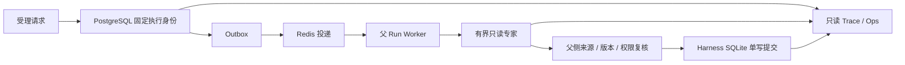

# EduAgent 技术面试证据索引

核对日期：2026-11-02。运行证据基线为 `e4ea5c3`，Task 10 实现与
fixture-only 工程验收绑定 source revision `f8b8e3c`。最新文档与主线同步记录见
[GitHub 分支对比与发布归档](github-publication-20261102.md)。M1 Durable Run Plane、
M2 Bounded Expert Plane 和 M3 Trusted Policy Promotion 的实现链路均已落地。

Task 10 已完成真实 PostgreSQL/Redis 多进程测试、SIGKILL 接管、自动回滚、
Compose 动态 smoke 和远程 CI。Task 9 的 Policies 功能已验证，但独立审查未完整
封存；正式 eligible Judge v3 campaign rehearsal 因缺少外部前置条件未执行。
这些边界不能被改写为“正式策略已发布”或“模型/学习效果已提升”。

本页只维护可用于面试陈述的当前事实与证据入口。现场话术见
[面试讲解手册](interview-playbook.md)，分层技术追问见
[技术深挖手册](interview-technical-deep-dive.md)。

项目适合从三个问题展开：如何可靠执行 Agent，如何保护学习证据，
如何判断一项算法修改是否值得发布。每个问题都应能定位到机制、
失败用例与可复现结果。

## 已有机制与证据

| 面试问题 | 机制与实现入口 | 可检查证据 | 适用边界 |
| --- | --- | --- | --- |
| Worker 崩溃后谁有提交权？ | PostgreSQL Run/Lease、单调 fencing token、Outbox；[repository](../../python/core/distributed/repository.py) | [Run Plane 故障矩阵](distributed-run-plane.md)、[真实等锁回归](../../python/tests/distributed/test_lease_lock_time.py) | Redis 只投递；外部模型副作用不承诺 exactly-once |
| 专家如何并行计算而不乱写学生状态？ | 冻结快照、独立专家租约、双重 fencing、父侧结果复核；[expert_repository](../../python/core/distributed/expert_repository.py) | [Expert Plane](bounded-expert-plane.md)、[强杀接管原始 JSON](../superpowers/reports/demo-startup-final.json) | 父侧 Harness SQLite 仍单写；accepted draft 不等于公开交付 |
| 超时与取消是否真正释放资源？ | 有界预算、deadline、取消 drain 后释放存储锁 | [并发边界](harness-concurrency-20261029.md)、[Shadow 取消与锁审查](../superpowers/reports/2026-11-01-m3-task7-shadow.md) | 不响应取消的内部任务会持续持锁，不能声称强制终止 |
| 获得提示后答对能否算掌握？ | 首次独立作答与受助证据分离，回复/测验/学习状态同一 SQLite 事务 | [Tutor Harness 回归](../../python/tests/test_tutor_harness.py)、[L05 原始分析](../evals/harness-long-runs/20261027-source-recovery-deepseek-flash/analysis.md) | 学习状态模型与教学效果实验是不同层次 |
| Judge 输出格式正确是否就可信？ | v3 verdict/reason/criterion/evidence 一致性校验，一次 repair，失败归 unknown；[Judge v3](../../python/evals/optimization/judge_v3.py) | [v3 测试](../../python/tests/evals/test_judge_v3.py)、[评分重放](../../python/evals/optimization/gates.py) | schema 有效不证明语义正确；unknown 不授予资格 |
| 如何避免新旧策略混跑？ | 受理时固定 policy/deployment/namespace，尝试与专家继承；[policy_assignment](../../python/core/distributed/policy_assignment.py) | [版本固定回归](../../python/tests/distributed/test_policy_pinning.py)、[Task6 审查](../superpowers/reports/2026-11-01-m3-task6-execution.md) | 自动回滚只影响新受理 Run；真实多进程 fixture 已验证旧 Run binding、新 Run stable binding 和迟到 observation，但 fixture 不授予正式发布资格 |
| 如何证明候选没有污染主状态？ | 无提交权的 Shadow 执行、专用 store 与 stream、文件锁 | [Shadow 回归](../../python/tests/distributed/test_shadow_worker.py)、[Task7 审查及 JUnit](../superpowers/reports/2026-11-01-m3-task7-shadow.md) | 隔离执行证明工程边界，不能证明候选改善教学质量 |
| 缺少费用或结构判定时能否晋级？ | 全尝试账本、真实判定分子/分母、缺失证据 HOLD；[policy_health](../../python/core/distributed/policy_health.py) | [Task8 实现与冻结测试](../superpowers/reports/2026-11-01-m3-task8-health.md)、[健康回归](../../python/tests/distributed/test_policy_health.py) | fixture 的 Decimal 费用只检验算法；实际费用缺失保持 unknown；Task8 已验收，正式模型资格仍缺独立证据 |
| 两个 evaluator 同时回滚怎么办？ | 同事务冻结观察集合、锁定 head、CAS 更新、审计与 Outbox；观测发布共享 head 锁，已消费前序硬违规不被滚动窗口淘汰 | [Task8 原因链修复完整 JUnit](../../python/tests/distributed/evidence/2026-11-01-m3-task8-cause-full.xml)、[真实发布交错回归](../../python/tests/distributed/test_policy_health_publication.py)、[独立代码审查](../superpowers/reports/2026-11-02-m3-task8-code-recovery.md) | 独立完整后端 1607 项通过，SPEC/CODE PASS；Task 10 多进程 fixture 已验证自动回滚与迟到 observation |

## 岗位阅读路径

### Harness 工程主线

1. 权威状态与投递解耦；
2. lease、fencing 和锁后权限复核；
3. 有界专家计算与唯一业务写权限；
4. policy identity、Shadow、Canary 和事务化回滚；
5. Trace、故障注入和证据边界。

### Agent 算法支线

1. Tutor/Coordinator 的工具选择、预算和来源授权；
2. 自动契约、Judge v3、`unknown` 与语义质量；
3. 开发重放、独立校准、留出集和正式发布资格；
4. 算法候选如何进入 Shadow/Canary，而不是直接替换线上策略。

可直接使用的话术、白板顺序和演示步骤统一放在
[面试讲解手册](interview-playbook.md)；本页不再复制脚本。

## Agent 算法证据补充

具体失败、改动触发计数、固定配置、费用区间和逐条回复见
[第五轮分析](../evals/harness-long-runs/20261027-source-recovery-deepseek-flash/analysis.md)。
这是历史评分 v2、重复开发场景的单次回归，不能授予当前 Judge v3 发布资格。
展开 RRF、rerank、发现候选、来源门禁与有界纠错时，可使用
[算法面试证据卡](agent-algorithm-evidence.md)定位源码；它也列出工具语义评分的
非盲审阅边界，以及按用户要求暂停的 Agent50 语义审阅状态。
离线优化历史与独立校准缺口见
[RSI 核验](../evals/rsi-review-20261027/verification.json)、
[校准状态](../evals/rsi-review-20261027/calibration-status.json)、
[混合评分开发重放](../evals/rsi-review-20261029/analysis.md)。

## 当前证据矩阵

| 范围 | 当前事实 | 可以主张 | 不能主张 |
| --- | --- | --- | --- |
| M1 Run Plane | PostgreSQL/Redis 真实多进程接管通过 | 可恢复、可审计、旧 token 不能提交 | 外部副作用 exactly-once |
| M2 Expert Plane | SIGKILL 接管、唯一 accepted result、父侧采用 | 专家计算可独立恢复且不能直接写学习状态 | learner-state 水平多写 |
| M3 Promotion | fixture Shadow/Canary/rollback 与 Compose CI 通过 | 控制面实现和工程故障路径通过 | 正式策略可发布 |
| Task 9 Ops | 功能、build 和 54 项 Playwright 已验证 | 可查看脱敏策略证据 | 独立验收完整封存 |
| 正式 rehearsal | 未执行 | 缺失前置条件会 fail closed | 真实模型效果提升 |
| 教学效果 | 未进行真实学生因果研究 | 独立/受助证据被区分记录 | 学习效果提升 |

绑定 `f8b8e3c` 的最终验证结果为：非分布式 `850 passed, 56 skipped`，
PostgreSQL/Redis 分布式矩阵 `1537 passed`，Ops Playwright `54 passed`；
GitHub Actions backend、frontend、package、compose-smoke 和
distributed-integration 均成功。详见
[Task 10 验收记录](m3-policy-promotion-acceptance.md)和
[远程 CI #41457794154](https://github.com/codedog678/eduagent/actions/runs/41457794154)。
