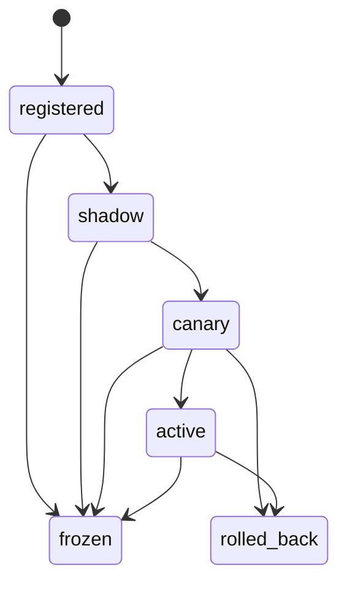
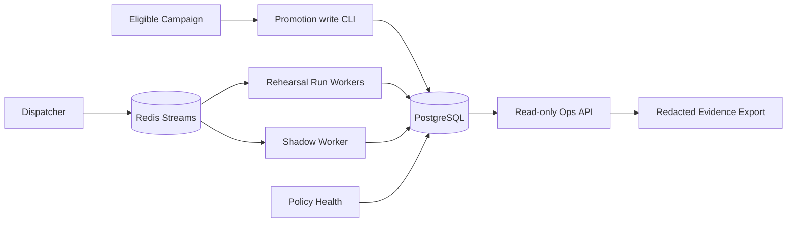

# Trusted Policy Promotion

## 目标与权威边界

M3 在 `rehearsal` 环境验证一份已经通过正式资格门禁的 Tutor policy。PostgreSQL
是 artifact、deployment、receipt、observation、health window 与 audit 的权威
存储；Redis Streams 只提供投递提示。模型生成内容、Redis 消息、Ops 投影和
本地证据文件都不能单独授权晋升。

| 资产 | 权威来源 | 关键不变量 |
| --- | --- | --- |
| Policy artifact | PostgreSQL | canonical hash、runtime/source/protocol 一致 |
| Qualification receipts | PostgreSQL append-only | 四类正式 receipt 完整且绑定同一 artifact |
| Deployment head | PostgreSQL | environment/version CAS；状态单向转换 |
| Run assignment | admission transaction | token 单次消费；deployment 绑定不可重写 |
| Health observation/window | PostgreSQL | 冻结阈值、匹配窗口、来源身份均可复算 |
| Evidence export | 只读 Ops + metrics | `controlled_rehearsal`，永不自动成为发布资格 |

## 状态机



状态转换由独立 `promotion_cli` 写平面完成，必须携带 expected version、当前状态、
actor 和 command id。Ops API 只读，不提供 retry、rollback 或 lease steal。

## 数据流



Rehearsal 与 Shadow worker 使用各自的专用卷，不挂载 production Harness。生产
Run worker 也不挂载 rehearsal/shadow 数据。Shadow 结果只能形成隔离 observation，
不能提交 learner state 或替换 primary result。

## 资格与 Judge 语义

正式注册要求 campaign 为 `simulation=false`、`mode=qualification`、
`state=eligible`，协议为当前 `eduagent.gepa.v3`，且包含：

1. campaign eligibility；
2. Judge calibration；
3. formal holdout；
4. Harness qualification。

Judge v3 的 `unknown` 是证据不足，不是失败文本的别名。自动评分最多进行一次
受约束 repair；repair 后仍无法形成结构化判断时保留 unknown，并进入 health
unknown-rate 计算。开发 replay、simulation、exploratory 或 test fixture 都不能
替代独立发布资格。

## 分配与版本继承

分配输入为：

```text
HMAC-SHA256(
  assignment_secret,
  environment || NUL || deployment_id || NUL || learner_id || NUL || request_id
)
```

取摘要前 8 字节的大端整数并对 10000 取模。Canary 中 bucket 小于
`traffic_basis_points` 时进入 candidate；Active 全部进入 candidate；其他状态为
stable。签名 rehearsal token 同时绑定 learner、request、operation、deployment
id/version、namespace、fault profile、nonce 和有效期，nonce 只存摘要且只能消费
一次。

Run 在 admission 时冻结 `deployment_id`、policy hash、cohort 与 namespace。
Worker crash 后更高 fencing token 的接管仍继承原绑定；deployment head 变化不能
改写已接受 Run。新 Run 才读取新 head。

## Health 与自动回滚

默认阈值：

| 指标 | 默认门槛 |
| --- | ---: |
| candidate / stable 最小样本 | 20 / 20 |
| 最大窗口 | 各 50 |
| commit failure rate | `>= 0.05` 失败 |
| terminal failure rate | `>= 0.10` 失败 |
| unknown rate | `>= 0.10` 失败 |
| p95 latency increase | `>= 0.50` 失败 |
| mean cost increase | `>= 0.30` 失败 |

相对增幅使用 `(candidate - stable) / max(stable, epsilon)`。成本或结构化决策
不可用时窗口保持 hold，不能当作 pass。Canary 必须使用匹配 stable/candidate
样本；Shadow 必须证明隔离。

Policy-health 在一个 PostgreSQL 事务中锁定 deployment/head，复核阈值 hash、
window 与 observation 绑定，写入失败 window、回滚 deployment、新 stable head
和唯一 audit。迟到 observation 可以留档，但不能移动已经变化的 head。

## 故障矩阵

| 故障 | 预期结果 |
| --- | --- |
| simulation/exploratory/non-eligible campaign | `Campaign.open` 和任何写入前拒绝 |
| receipt、runtime、source 或 Judge v3 不匹配 | 注册失败，不产生可服务 candidate |
| token 过期、篡改、复用或请求不匹配 | admission 401/409，不接受 Run |
| Run worker claim 后 SIGKILL | 更高 token 接管；policy binding 字节不变 |
| Shadow 尝试写 learner state | 隔离失败；不能成为 passing receipt |
| 成本/结构化判断缺失 | health hold，不作通过推断 |
| candidate commit failure 达阈值 | 原子 rollback；恰好一条 rollback audit |
| 旧 deployment 迟到 observation | 仅留证据；head 不回退 |
| Ops/Redis 不可用 | 写入授权不转移；PostgreSQL 仍为权威 |

## 运行命令

Compose 需要显式注入 secret，仓库不提供默认值：

```bash
set -a
source .env
set +a
export PROMOTION_FAULT_INJECTION_ENABLED=true
docker compose --profile distributed up --build -d
```

`.env` 中的数据库密码和 promotion secret 应在首次初始化时生成并持久化，后续
启动复用同一组值。已有 `pgdata` 时不要重新生成数据库密码。

本地真实基础设施集成测试：

```bash
cd python
DISTRIBUTED_TEST_DATABASE_URL="$TEST_DATABASE_URL" \
DISTRIBUTED_TEST_REDIS_URL="$TEST_REDIS_URL" \
python -m pytest tests/integration/test_policy_promotion.py \
  --junitxml=/tmp/eduagent-m3-policy-promotion.xml -q
```

CI 执行 `.github/workflows/ci.yml` 的 `distributed-integration` 与
`compose-smoke`。前者归档 JUnit 和明确标记
`evidence_role=test_fixture, release_eligible=false` 的 JSON；后者只归档结构化
smoke JSON 与进程状态，不归档 resolved Compose 或整段原始日志。

正式演练：

```bash
python tools/run_policy_rehearsal.py \
  --api-url http://127.0.0.1:8890 \
  --ops-token env:OPS_API_TOKEN \
  --campaign "$ELIGIBLE_CAMPAIGN" \
  --actor "$PROMOTION_COMMAND_PRINCIPAL" \
  --candidate-basis-points 5000 \
  --healthy-runs 48 \
  --failure-runs 20 \
  --output docs/engineering/evidence/m3-policy-rehearsal
```

## 证据字段

七个输出文件都携带 source revision、runtime/protocol/threshold hash、
provider/model identity、data role、请求/失败/中断计数和成本账本。JSONL 即使
没有业务记录也写 metadata record。`manifest.json` 声明完整文件集；
`requests.jsonl` 只含公开 Run 状态；receipt/window/audit 来自只读 Ops；
`prometheus.txt` 在注释中绑定 metadata；`summary.md` 明确非生产流量与非学习
效果证明。

driver 不把 token 或 nonce 传给子进程 argv，不回显 promotion CLI 原始 stdout，
每个 token 只在内存中用于一次 HTTP 请求。输出在临时目录完成敏感值扫描后原子
发布。

## 当前限制与非主张

- learner state 仍是单写 Harness SQLite，不证明水平多写；
- PostgreSQL 与 SQLite 没有跨库原子事务；
- model request 与计费不承诺 exactly-once；
- rehearsal 只验证控制面、隔离、恢复与回滚，不证明教学质量或学习效果；
- test fixture、template provider 和开发 replay 不能成为 release qualification；
- Ops bearer token 不是生产级 RBAC；部署仍需网络边界、身份系统和最小权限账号；
- 正式演练依赖真实 eligible campaign、匹配 runtime/source 与配置好的模型凭据。
