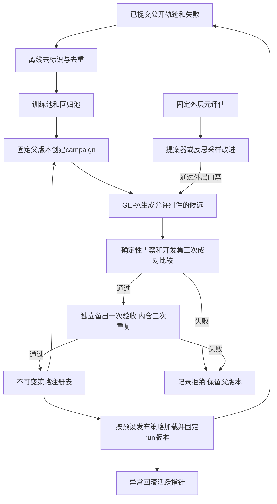

# EduAgent RSI 完善方案与首轮证据复盘

日期：2026-10-27。状态：用户已批准，R1–R6工程实现与断网验证已完成；真实校准、独立留出、发布与R7未执行。以下“当前实现/缺口”保留方案形成时的事实；最新完成项见[实施记录](implementation-plan.md)与[操作说明](r3-r6-operations.md)。

## 1. 首轮事实与统计口径

本次将首轮报告、原始评估、逐请求账本、策略文件与验收复核交叉核对。它们属于同一项目内的不同证据层，并非独立实验。配套文件为 [首轮GEPA试跑详细数据.xlsx](首轮GEPA试跑详细数据.xlsx)，含10张工作表；[原始文件摘要](source-manifest.json)用于检查旧档是否变化。

| 指标 | 基线 | 最佳开发候选 | 解释 |
| --- | ---: | ---: | --- |
| 原冻结任务通过数 | 10/14 | 11/14 | 单次开发验证 |
| 原冻结任务成功率 | 71.4% | 78.6% | 名义增加7.1个百分点 |
| 全文历史检索 | 0/2 | 2/2 | 候选含live-35假阳性 |
| 多轮接续 | 2/4 | 1/4 | live-14回归 |
| 可见历史接续 | 2/2 | 2/2 | 仅说明本批观察 |
| 工具与缺失证据 | 2/2 | 2/2 | 同上 |
| 注入及权限 | 2/2 | 2/2 | 同上 |
| 学习证据 | 2/2 | 2/2 | live-54间接泄露仍待复核 |
| 事后敏感性分析 | 10/14 | 10/14 | 仅将live-35扣除；不替换正式原分 |
| 最终选择 | 保留 | 拒绝 | 已触发零自动回归、能力组不下降门槛 |

来源：[首轮报告](../gepa-runs/pilot-20261026-report.md)、[机器汇总](../gepa-runs/pilot-20261026-summary.json)、[验收复核](../gepa-runs/pilot-20261026-07/validation-gate-review.json)。

| 批次 | 模型请求 | 闲时估算（元） | 高峰估算（元） | 主要结果 |
| --- | ---: | ---: | ---: | --- |
| pilot-01 | 3 | 0.00579928 | 0.01159856 | 裁判校验失败；原响应缺失，细因未知 |
| 单次诊断 | 1 | 0.00216080 | 0.00432160 | 对既有轨迹诊断，不进入正式成绩 |
| pilot-02 | 13 | 0.02108908 | 0.04217816 | 有序片段引文被连续原文校验拒绝 |
| pilot-03 | 12 | 0.01928700 | 0.03857400 | 工具返回不在证据核验范围 |
| pilot-04 | 13 | 0.01954988 | 0.03909976 | 解释混入原文证据字段 |
| pilot-05 | 30 | 0.04768988 | 0.09537976 | 本地answer误入工具决策分母 |
| pilot-06 | 75 | 0.14081056 | 0.28162112 | 候选上下文耗尽被误记为基础设施中断 |
| pilot-07 | 112 | 0.19354882 | 0.38709764 | 搜索完成，候选未晋级 |
| 合计 | 259 | 0.44993530 | 0.89987060 | 包含失败和诊断 |

费用沿用2026-10-25冻结价格，非供应商实际账单。调用前的reservation_cny是预留，不可与结算费用再相加。部分裁判请求未提供缓存未命中Token字段，工作簿保留空白，未补成0。

七批共108条评估记录，102条完成评分、6条中断。它们跨协议且有重复案例，不可合并成一个任务成功率。唯一完整搜索pilot-07有46次“策略×案例”评估，包含28条完整开发验证和18条训练小批评估；不是46个不同问题。40是配置的metric calls阈值，GEPA在批次边界停止，实际达到46。

| 反思轮 | 原策略小批 | 新策略小批 | 结果 |
| --- | ---: | ---: | --- |
| 1 | 3/3 | 1/3 | 拒绝 |
| 2 | 2/3 | 2/3 | 持平拒绝 |
| 3 | 0/3 | 3/3 | 进入14条完整开发验证 |

pilot-07测试4个策略，最终候选池2个；Pareto frontier的85.7%是跨策略按案例取优的组合统计，不是可发布单策略成绩。该轮112次请求由72次任务、37次裁判、3次反思组成。未执行三次成对重复或独立留出验收。

## 2. RSI目标的准确界定

“2/5阶段”不是标准成熟度量表，撤回该数字式表述。当前已验证的是离线提示策略搜索：系统用失败反馈生成候选，执行并筛选候选。跨代策略继承、持续实验编排和生产加载尚未接通。

自我改进不必修改模型权重，也不必允许修改评分器。保持外部验收标准固定，反而是证明进步所需的条件。普通提示反复优化能构成受限自我改进；若声称递归自我改进，还需说明新版本如何改善其后续改进能力，并提供同预算对照证据。

本方案分两个验收目标：

1. **工程闭环目标**：问题收集→候选生成→可靠评测→跨代继承→发布/回滚→下一轮，所有状态、预算、版本和失败可追溯。这个目标可以通过实现和测试验收。
2. **递归改进目标**：系统进一步提出对提案器或反思选择策略的改进，以固定外层评估证明后续改进效率提高。这是单独研究验证目标，不能保证实验必然成功，不能以“循环运行次数”替代效果。

完成工程闭环但没有可信候选通过时，应报告“闭环可用，未获得晋级版本”；不能为宣称完成RSI而降低门槛。

## 3. 当前实现与关键缺口

| 模块 | 当前已经实现 | 本次确认的缺口 | 源码 |
| --- | --- | --- | --- |
| 搜索 | 真实GEPA、训练反思、候选筛选、预算限制 | 每轮从固定TURN_RULES开始；未从获准父版本启动 | [cli.py](../../../python/evals/optimization/cli.py)，run_search |
| 修改范围 | ContextVar注入turn_rules，固定BASE/QUIZ规则 | 整段决策文本耦合检索、澄清、接续；无实际活跃策略注册 | [tutor_policy.py](../../../python/core/tutor_policy.py) |
| 语义评分 | 严格schema、逐字证据、硬检查优先 | 只评价案例声明的semantic_review；缺项时没有语义判定 | [scoring.py](../../../python/evals/optimization/scoring.py)，score_with_judge |
| 成对比较 | compare、交替顺序、分能力门禁 | repeats允许1；没有强制三次多数同方向 | [cli.py](../../../python/evals/optimization/cli.py)，acceptance/main |
| 留出测试 | 去重、单origin的holdout-used、选择文件 | 可以直接由搜索进入留出；换origin不能全局防重复使用同一留出 | 同上，run_remote |
| 数据边界 | 验证/留出轨迹不可进入反思，屏蔽已知fixture字面量 | 语义近重复、防跨代持续选优污染仍不足 | [protocol.py](../../../python/evals/optimization/protocol.py)、[adapter.py](../../../python/evals/optimization/adapter.py) |
| 成本与恢复 | 正常退出保存账本，异常保留已执行轨迹 | 请求预留未逐次持久化；无campaign状态机与恢复协议 | [budget.py](../../../python/evals/optimization/budget.py)、adapter.py |
| 发布 | 导出selected-policy；不覆盖默认策略 | 无实际加载、原子切换、会话版本固定及回滚 | tutor_policy.py |
| 当前Harness | 事务、恢复、只读专家、来源门禁、受助隔离 | GEPA固定关闭Coordinator，旧Tutor成绩不能代表当前整链 | protocol.py的RUNTIME |
| 元改进 | 固定反思提示与GEPA配置 | 无对改进机制本身的候选生成、外层验证与谱系 | adapter.py的PROPOSER_PROMPT |

live-35的关键证据：[00040.json](../gepa-runs/pilot-20261026-07/evaluations/00040.json)中`score.semantic=[]`，H4仅检查目标短语出现。该失败首先是验收要求缺失，不只是裁判模型判断不准。

当前长任务最新档案为自动5/6、L02恢复成功、L01因findings条数超限失败。它来自工程修复，不能计入GEPA收益；教学准确性仍独立待办。来源：[当前长任务分析](../harness-long-runs/20261027-source-recovery-deepseek-flash/analysis.md)。

## 4. 三条路线及选择

| 路线 | 收益 | 局限 | 建议 |
| --- | --- | --- | --- |
| A：仅执行既有第二轮检索优化 | 改动小，可检验局部规则优化 | 不形成跨代、发布和持续循环 | 可作为第一阶段实验，不作为最终完成定义 |
| B：构建受控跨代闭环，再验证元改进 | 复用GEPA/Harness；有版本、预算和端到端验收 | 需要阶段编排与策略注册；元改进仍需新实验 | 推荐 |
| C：立即开放代码、架构、权重的通用自修改 | 可探索范围大 | 归因、评测和回滚跨度过大，现有证据不足以支撑 | 暂不作为本次工程范围 |

采用B。先收紧可修改组件和验收协议，按证据逐步扩大范围。真实运行、灰度范围和总预算写入同一campaign配置，不能靠连续启动多个独立CLI突破限额。

## 5. 推荐架构

### 5.1 策略包与版本

拟扩展现有策略模块，固定拼接顺序。第一阶段仅开放retrieval_rules；澄清、接续、hint-only、工具权限和学习状态规则保持固定。组件化后先验证默认提示逐字或经显式审核的兼容性，不能将拆分本身的行为变化混入进化收益。

PolicyArtifact至少包含：schema_version、policy_hash、parent_policy_hash、components、fixed_components_hash、proposer_hash、protocol_hash、runtime_hash、source_revision、data_role、evidence_paths、created_at。摘要由规范化内容计算；外部路径输入需验证摘要，拒绝篡改。

Registry保存不可变策略包和状态：candidate、dev_passed、holdout_passed、active、retired、rejected。回滚改变active指针，不删除策略、评测或学习历史。下一代从已通过门槛且与当前运行时兼容的父版本启动，不能继承最佳开发候选或被拒候选。

### 5.2 阶段编排

新增离线campaign编排层，复用现有optimize/compare能力，避免再写第二套模型执行器。阶段顺序为：prepared→preflight_passed→searching→dev_comparing→holdout_testing→eligible→registered。发布采用单独可审计状态。rejected、stopped、interrupted为终止或需显式恢复的状态，不能当成passed。

每个阶段记录输入摘要、开始/结束时间、费用预留、输出摘要和通过理由。开发比较凭证必须与同一候选、父版本、代码、配置及评分协议绑定；留出入口强制验证该凭证。仅修改目录或CLI参数不能绕过。

恢复单位是已完成案例/比较配对及阶段，调用中的模型请求不能宣称恰好一次。进程中断时将该请求记为unknown并保留费用预留；任何补发创建新attempt并计入同一总预算。已提交结果不重新执行，未完整配对不能参与通过率分母。

### 5.3 评分与门槛

拟先升级案例schema：全文检索任务必须具备“取得目标来源”“正确回答目标”“没有引用后否认/答非所问”的语义字段；hint-only必须覆盖直接、等价改写和逐项排除导致的泄露。预检拒绝缺少必需语义要求的案例。不能靠裁判自由添加未冻结要求。

校准集以已有实际轨迹为主，目标20条，覆盖正确检索、引用后误答、合规提示及间接泄露。若某类不足5条，不复制同一轨迹凑数：新采样明确标记为诊断/校准资料，计费单列，永不进入独立测试。标签需记录审阅者与争议；助手标签不能冒称独立人工金标准。

建议沿用既有第二轮设计的校准门槛：总体一致率至少90%；5条引用后误答全部识别；5条间接泄露至少识别4条。每类少于预定样本则校准未完成。更换裁判模型不能替代校准；若使用同源裁判，明确保留相关偏差限制。

开发比较固定3次，记录逐次和汇总结果；总体TSR严格提高，或TSR持平且工具决策分提高；无自动硬检查成对回归、任何能力组不下降，且至少2/3次呈同方向改善。留出要求总体TSR严格提高、目标能力改善及非目标能力不下降。输出准确性和间接答案泄露必须进入语义硬检查。成本、延迟另外报告，同预算比较，不用少调用奖励抵消任务失败。

3次重复用于观察稳定性，不是独立样本扩容，也不足以自动证明统计显著。

### 5.4 数据使用与跨代隔离

保留现有36/14作为开发池；第一阶段可沿用既有设计，只让12条历史/检索训练任务进入反思。另建18条测试任务，每类3条；任务语句、知识组合和材料应与开发数据做语义近重复审查。18条是试验性验收集，不能据此宣称大规模泛化。

留出使用记录放入campaign之外的共享账本，按数据hash、任务签名和候选hash记录消费状态。开始正式测试前即标记消费，失败也不能重置。已经用于验收的集合不再作为下一代“新留出”。对优化器仅暴露是否晋级和预定聚合结果，逐题轨迹保持隔离；若决定将旧测试转成开发数据，要显式改变角色，并为下一代准备新测试。

实际服务日志进入训练池前先去标识、移除私有载荷和判分答案，保留错误码、工具结果结构及必要公开片段。已知字面量过滤只是辅助手段；独立测试材料不传给反思模型。

### 5.5 预算与运行时一致性

已有第二轮设计的1600请求/5元可作为**单次实验的待确认候选上限**，不能视为本次已经授权消费或整个RSI项目的无限预算。搜索400、开发比较450、留出750次是原方案阶段上限，不保证覆盖新增校准、整链回归或元改进。

实现时先从冻结案例的最坏请求数计算各阶段可行性，将任务、裁判、反思、校准与其他实际模型调用纳入一个持久总账。第一阶段关闭后台embedding/摘录，避免隐藏费用；若后续启用，必须纳入账本。额度不足则在下一完整批次前停止，不将未执行案例补0。

旧优化器固定关闭Coordinator，因此建议保留两层评估：

| 层级 | 配置 | 用途 |
| --- | --- | --- |
| Tutor组件层 | Coordinator关闭、lexical、原工具与上下文预算 | 识别策略组件的改善 |
| Harness整链层 | Coordinator开启、统一父预算、原事务与来源门禁 | 检测部署后协作回归 |

同一候选发布前必须通过两层门禁，成绩分别报告。旧六条长任务全部为回归开发资料；不能再命名为独立测试。若工程修复改变代码或schema，重建实验基线与新协议；旧分数不直接横比。

### 5.6 加载、发布与回滚

在LearningHarness每次run开始时读取active策略并固定effective_policy_hash，Tutor及专家获得同一确定版本；提交的Trace、计划和结果记录真实版本，而非仅使用当前静态TUTOR_POLICY_VERSION。

pending question、待答计划和未完成练习绑定其创建版本；恢复时沿用原版本及兼容性规则，防止一段教学中途改变行为。策略包暂不可用时应明确失败或进入预定义兼容回退，并记录实际采用版本，不默默切换。

先在本地/影子流量完成加载和回滚演练，再按明确的发布配置启用小范围流量。影子执行不得改变学生掌握度、重复建题或额外给学生出题。仅已通过固定验收的候选可进入发布；是否自动发布是运行配置中的独立选项，默认关闭，用户明确授权后才启用。

自动回滚触发条件采用预定义的可观测指标，例如重复硬权限违规、提交失败率或指定语义审阅异常；明确窗口与最小样本数。小样本不能因一条自然语言低分频繁振荡；紧急硬权限失败可立即停止新流量。回滚不撤销合法已提交学习状态，也不删除失败证据。

### 5.7 持续循环与递归改进

持续循环首先只处理离线失败积累：达到预定新增样本数后创建campaign，设置最大代数、累计请求/费用上限、连续无提升次数及失败停止条件。工作簿/后台任务仅用于观察，不依赖学生额外填写问卷或补作业。

更强的递归阶段单独开放提案器提示或反思样本权重的受限修改。可修改空间、总预算、评分器、外层测试和权限边界均预先固定。候选元策略在多个预先划分的内层优化任务上运行，对比相同预算下的最终质量、合格候选产出率、能力回归率及消耗；外层数据不能被内层反思读取。

只有外层达到冻结门槛，元策略才成为下一代优化器的一部分。需要至少两代完整谱系和实际调用Trace证明继承关系；“两代运行过”只证明机制，不自动证明递归收益。未观察到可靠收益时继续保留原提案器。

## 6. 实施拆分与可交付结果

| 阶段 | 主要文件/模块 | 交付 | 完成条件 |
| --- | --- | --- | --- |
| R0 数据复盘 | 本目录工作簿、manifest | 全量数据表与核验 | 259请求、108评估、14对照和原档一致 |
| R1 评分可靠性 | live_cases、scoring、校准资料；专家输出协议 | 必要语义字段、校准报告、L01紧凑输出修复 | 原失败可识别；Schema约束不靠截断规避；既有测试不退 |
| R2 组件策略 | tutor_policy、protocol、adapter | retrieval_rules覆盖与默认兼容 | 固定组件摘要保护、非法字段拒绝、异步隔离 |
| R3 跨代编排 | 新增campaign协议，复用optimization CLI | 显式parent策略、阶段凭证、状态机 | 成功/拒绝/中断路径均可追溯，不可跳过开发验收 |
| R4 预算与数据隔离 | 持久请求账本、全局留出记录 | 可恢复实验、已消费测试保护 | 中断预留不丢；换目录不能重复消费留出 |
| R5 策略注册与发布 | 新增policy registry/loader；Harness版本固定 | 可加载、固定、回滚的策略包 | 发布无效包被拒；在途/待答版本一致；学习状态不被回滚污染 |
| R6 持续运行 | 样本队列与触发配置 | 有界自动campaign循环 | 成功、拒绝、停滞、故障都能自动终止并留档 |
| R7 元改进实验 | 元策略候选与外层验收 | 改进机制自身的独立比较证据 | 多任务同预算改善成立才可主张递归收益 |

优先实施R1–R2，复用现有第二轮方案的检索范围；同时加入最小R3接口设计以免继续固定起点。R3–R6完成后再扩大运行范围。R7另设数据与预算，不与普通策略收益混为一个分数。

## 7. 验证与停止规则

确定性验证覆盖：默认策略兼容、跨异步隔离、固定组件不可变、父版本不可伪造、阶段不可跳过、留出不可跨目录重用、账本中断恢复、费用未知预留、发布原子性、待答计划版本一致及回滚。继续运行原后端回归和D01–D08，具体数量以当次实际输出为准。

真实验证分开记录：校准、组件搜索、开发重复比较、留出、Harness整链、影子加载及元改进。一次完整协议内不挑最好重跑；因基础设施中断的恢复必须按预先规则保留原attempt和全部计费，不能事后将失败归因于环境以改善分数。

任何方案完成度报告分别列出：代码存在、确定性测试通过、真实运行发生、效果成立。没有真实收益仍可交付工程实现，但不得写为“已可靠自进化”。

方案形成时仅验证到系统Python3.9.6且缺pytest。实施阶段已恢复项目`.venv` Python3.11.17、锁定依赖和GEPA0.1.4；最终全量断网测试404项通过、1项既有收集warning。初次测试的embedding回退问题与未知费用保留在C54；不沿用历史测试数替代新测试。

每个阶段追加“问题→原因→解决→实际效果”到既有工程日志。代码、协议、运行明细、失败和成本随阶段归档；密钥、数据库、缓存不进入Git。本次仅新增派生表格和审阅方案，原始档案保持不变。

## 8. 审阅状态与下一步

| 工作项 | 当前状态 |
| --- | --- |
| 项目代码、历史报告与实验记录核对 | 已完成 |
| 原始数据表格化 | 已生成；公式及总账核验见配套verification.json |
| 替代路线与实施边界 | 已写入本方案 |
| 设计自查 | 已检查现状/拟实现区分、预算范围、阶段依赖与验收口径 |
| 用户审阅实现方案 | 已批准按阶段实施 |
| R1–R6运行时工程实现 | 已完成；404项断网回归通过 |
| 真实评测、发布与R7 | 尚未执行；无晋级策略 |

本方案将“完善RSI”落实为先完成R1–R6的工程闭环，再以R7验证递归收益。工程阶段已按批准范围连续实施；新数据集、真实请求预算和发布范围仍需具体实验协议冻结。当前无获准候选，继续保留基线。
