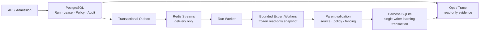

# EduAgent Interview Story and Technical Depth Implementation Plan

> **For agentic workers:** REQUIRED SUB-SKILL: Use superpowers:subagent-driven-development (recommended) or superpowers:executing-plans to implement this plan task-by-task. Steps use checkbox (`- [ ]`) syntax for tracking.

**Goal:** Reframe EduAgent's GitHub entry point around its evidence-driven Agent Harness, then derive a consistent interview playbook and technical deep-dive from the same verified M1-M3 evidence.

**Architecture:** Treat `docs/engineering/interview-readiness.md` as the curated fact index backed by the M1-M3 authority documents and the Task 10 acceptance record. `README.md` presents the public narrative, while the playbook and deep-dive vary presentation depth without inventing new claims. This is documentation-only work; no runtime, configuration, CI, or test code changes are allowed.

**Tech Stack:** GitHub-flavored Markdown, Mermaid, `rg`, POSIX shell, Git.

---

## File Map

| File | Responsibility | Change |
| --- | --- | --- |
| `docs/engineering/interview-readiness.md` | Current, source-linked interview fact index | Replace stale Task 9/10 status, reduce duplicated scripts, add final evidence matrix |
| `README.md` | Public GitHub landing page | Reorder around Harness problem, M0-M3 evolution, authority boundaries, proof, demo, and honest limits |
| `docs/engineering/interview-playbook.md` | Spoken interview delivery | Create 30-second, 3-minute, and 10-minute scripts plus whiteboard/demo flow |
| `docs/engineering/interview-technical-deep-dive.md` | Layered technical follow-up guide | Create six topic groups with L1-L4 answers, source links, failures, trade-offs, and limits |

Authoritative inputs:

- `docs/engineering/distributed-run-plane.md`
- `docs/engineering/bounded-expert-plane.md`
- `docs/engineering/trusted-policy-promotion.md`
- `docs/engineering/m3-policy-promotion-acceptance.md`
- `docs/superpowers/specs/2026-11-02-interview-story-technical-depth-design.md`

Do not update acceptance or historical evaluation documents while executing this plan. They are evidence, not presentation surfaces.

### Task 1: Make the Interview Readiness Index Current

**Files:**
- Modify: `docs/engineering/interview-readiness.md:1-105`
- Reference: `docs/engineering/m3-policy-promotion-acceptance.md:3-106`
- Reference: `docs/engineering/bounded-expert-plane.md:217-290`

- [ ] **Step 1: Prove the index contains stale completion claims**

Run:

```bash
rg -n \
  'Task9 可启动|Policies 页面和完整灰度演练尚待验收|完整多进程闭环仍待 Task10|Task9 尚待实现|Task10 尚待实现|本机没有 Docker 动态烟测证据' \
  docs/engineering/interview-readiness.md
```

Expected: at least the stale lines near the introduction, mechanism table, and final checklist match. Record these matches in the task notes before editing.

- [ ] **Step 2: Replace the opening with a concise current-state contract**

Replace the long Task 8 chronology at `docs/engineering/interview-readiness.md:3-20` with text that contains all of the following facts:

```markdown
核对日期：2026-11-02。当前代码 revision 为 `e4ea5c3`，Task 10 实现与
fixture-only 工程验收绑定 source revision `f8b8e3c`。M1 Durable Run Plane、
M2 Bounded Expert Plane 和 M3 Trusted Policy Promotion 的实现链路均已落地。

Task 10 已完成真实 PostgreSQL/Redis 多进程测试、SIGKILL 接管、自动回滚、
Compose 动态 smoke 和远程 CI。Task 9 的 Policies 功能已验证，但独立审查未完整
封存；正式 eligible Judge v3 campaign rehearsal 因缺少外部前置条件未执行。
这些边界不能被改写为“正式策略已发布”或“模型/学习效果已提升”。

本页只维护可用于面试陈述的当前事实与证据入口。现场话术见
[面试讲解手册](interview-playbook.md)，分层技术追问见
[技术深挖手册](interview-technical-deep-dive.md)。
```

Keep the sentence that frames the project around reliable execution, learning evidence,
and algorithm release decisions.

- [ ] **Step 3: Correct stale mechanism-table boundaries**

Update the policy-pinning and rollback rows so they say:

```markdown
自动回滚只影响新受理 Run；真实多进程 fixture 已验证旧 Run binding、新 Run
stable binding 和迟到 observation，但 fixture 不授予正式发布资格。
```

Keep the existing source and test links. Do not change Task 8 historical review counts.

- [ ] **Step 4: Replace duplicated five-minute scripts with role routes**

Replace `## Harness 岗位：五分钟讲解` and `## Agent 算法岗位：五分钟讲解`
with `## 岗位阅读路径`. Use this exact structure:

```markdown
## 岗位阅读路径

### Harness 工程主线

1. 权威状态与投递解耦；
2. lease、fencing 和锁后权限复核；
3. 有界专家计算与唯一业务写权限；
4. policy identity、Shadow、Canary 和事务化回滚；
5. Trace、故障注入和证据边界。

### Agent 算法支线

1. Tutor/Coordinator 的工具选择、预算和来源授权；
2. 自动契约、Judge v3、`unknown` 与语义质量；
3. 开发重放、独立校准、留出集和正式发布资格；
4. 算法候选如何进入 Shadow/Canary，而不是直接替换线上策略。

可直接使用的话术、白板顺序和演示步骤统一放在
[面试讲解手册](interview-playbook.md)；本页不再复制脚本。
```

Retain the existing links to long-task analysis, algorithm evidence, RSI verification,
and calibration status under a short `## Agent 算法证据补充` section.

- [ ] **Step 5: Replace the stale final checklist with a final evidence matrix**

Replace `## 最终交付仍需核对` with:

```markdown
## 当前证据矩阵

| 范围 | 当前事实 | 可以主张 | 不能主张 |
| --- | --- | --- | --- |
| M1 Run Plane | PostgreSQL/Redis 真实多进程接管通过 | 可恢复、可审计、旧 token 不能提交 | 外部副作用 exactly-once |
| M2 Expert Plane | SIGKILL 接管、唯一 accepted result、父侧采用 | 专家计算可独立恢复且不能直接写学习状态 | learner-state 水平多写 |
| M3 Promotion | fixture Shadow/Canary/rollback 与 Compose CI 通过 | 控制面实现和工程故障路径通过 | 正式策略可发布 |
| Task 9 Ops | 功能、build 和 54 项 Playwright 已验证 | 可查看脱敏策略证据 | 独立验收完整封存 |
| 正式 rehearsal | 未执行 | 缺失前置条件会 fail closed | 真实模型效果提升 |
| 教学效果 | 未进行真实学生因果研究 | 独立/受助证据被区分记录 | 学习效果提升 |
```

Immediately below the table, link to the Task 10 acceptance record and remote CI run.
Add this bound verification snapshot so later checks do not rely on implied numbers:

```markdown
绑定 `f8b8e3c` 的最终验证结果为：非分布式 `850 passed, 56 skipped`，
PostgreSQL/Redis 分布式矩阵 `1537 passed`，Ops Playwright `54 passed`；
GitHub Actions backend、frontend、package、compose-smoke 和
distributed-integration 均成功。详见
[Task 10 验收记录](m3-policy-promotion-acceptance.md)。
```

- [ ] **Step 6: Verify stale statuses are gone and current boundaries remain**

Run:

```bash
! rg -n \
  'Task9 可启动|Task9 尚待实现|Task10 尚待实现|完整多进程闭环仍待 Task10|本机没有 Docker 动态烟测证据' \
  docs/engineering/interview-readiness.md

rg -n \
  'e4ea5c3|f8b8e3c|1537 passed|54 passed|未完整封存|正式 eligible Judge v3 campaign rehearsal|fixture' \
  docs/engineering/interview-readiness.md
```

Expected: the first command exits 0 because the negated search finds no stale text.
The second command shows the current revisions, evidence, and limitations.

- [ ] **Step 7: Commit the fact-index update**

```bash
git add docs/engineering/interview-readiness.md
git commit -m "docs(interview): refresh verified evidence index"
```

### Task 2: Reframe the GitHub README

**Files:**
- Modify: `README.md:1-336`
- Preserve and reposition: `README.md:337-631`
- Reference: `docs/engineering/interview-readiness.md`

- [ ] **Step 1: Prove the current first screen does not establish the M1-M3 story**

Run:

```bash
sed -n '1,80p' README.md | rg -n \
  'Durable Run Plane|Bounded Expert Plane|Trusted Policy Promotion|1537|SIGKILL|fencing'
```

Expected: no matches and a non-zero exit status.

- [ ] **Step 2: Write the new first-screen positioning**

Replace `README.md:1-7` with:

```markdown
# EduAgent

**面向有状态 Agent 的证据驱动执行与策略发布 Harness。**

EduAgent 以自适应教学为高一致性场景：一次答题会同时影响测验状态、掌握度、
公开回复和后续计划，因此重试、Worker 崩溃、专家委派或策略切换都不能造成重复
提交、越权写入或新旧策略混跑。项目从单机事务 Harness 演进到可恢复 Run Plane、
有界 Expert Plane 和可信策略晋升链路。

> 当前证据证明工程可靠性与证据安全，不证明真实模型质量或学生学习效果。

## 核心能力与证据

| 层次 | 解决的问题 | 关键机制 | 已验证证据 |
| --- | --- | --- | --- |
| M1 Durable Run Plane | Worker 崩溃后谁有提交权 | PostgreSQL lease/fencing、Outbox；Redis 仅投递 | 真实多进程接管与旧 token 拒绝 |
| M2 Bounded Expert Plane | 专家如何扩展又不乱写状态 | 冻结快照、双重 fencing、父侧采用 | SIGKILL 接管与唯一 accepted result |
| M3 Trusted Policy Promotion | 算法候选如何受控上线 | Judge v3、Shadow、Canary、健康窗口、回滚 | fixture 多进程闭环与远程 CI |

- 后端非分布式：`850 passed`，`56 skipped`
- PostgreSQL/Redis 分布式矩阵：`1537 passed`
- Ops Console：`54 passed`（desktop + mobile）
- 远程 CI：backend、frontend、package、compose-smoke、
  distributed-integration 全部成功

[查看当前证据索引](docs/engineering/interview-readiness.md) ·
[查看 Task 10 验收记录](docs/engineering/m3-policy-promotion-acceptance.md)
```

Do not add badges or claim that the formal eligible campaign rehearsal passed.

- [ ] **Step 3: Add the failure-driven M0-M3 evolution**

Immediately after the proof section, add:

```markdown
## 从能运行到可信交付

| 阶段 | 真实矛盾 | 设计决策 | 仍保留的边界 |
| --- | --- | --- | --- |
| M0 单机 Harness | 重试不能重复判分或污染学习证据 | 请求指纹、事务提交、独立/受助表现分离 | 单进程业务状态 |
| M1 Run Plane | lease 过期后的旧 Worker 仍可能继续运行 | 单调 fencing token，所有提交重新验证 authority | 外部模型副作用非 exactly-once |
| M2 Expert Plane | 专家要独立恢复，但不能拥有业务写权限 | 冻结只读快照、双重 fencing、父侧复核采用 | Harness SQLite 仍单写 |
| M3 Promotion | 离线分数不能直接授予生产发布权 | 资格绑定、Shadow、Canary、匹配健康窗口和事务回滚 | 正式 campaign rehearsal 未执行 |
```

Follow it with one paragraph explaining that each milestone started from an observed or
reproduced failure, not from adding infrastructure for its own sake.

- [ ] **Step 4: Replace the old top-level architecture with one authority-boundary diagram**

Before the existing learning-experience content, add this Mermaid diagram:



Under the diagram, state these three authority rules:

1. PostgreSQL is authoritative for distributed execution and policy identity.
2. Redis may duplicate delivery and never grants commit authority.
3. SQLite remains authoritative for the current teaching business transaction.

Remove or consolidate the old diagram at `README.md:97-141` so two contradictory
architecture diagrams do not remain.

- [ ] **Step 5: Add three concise deep cases**

Add `## 三个关键工程判断` with one subsection each:

1. `### 锁等待之后重新验证权限`
2. `### Expert 通过不等于公开交付`
3. `### 回滚不改写已受理 Run`

Each subsection must contain exactly four parts:

- failure;
- invariant;
- implementation/test link;
- limitation.

Use these source links:

- `python/tests/distributed/test_lease_lock_time.py`
- `python/core/distributed/expert_repository.py`
- `python/tests/integration/test_policy_promotion.py`
- `docs/engineering/trusted-policy-promotion.md`

- [ ] **Step 6: Add a five-minute reproduction route and honest limits**

Add `## 五分钟看懂项目` with:

```bash
docker compose --profile distributed up --build -d
curl --fail http://localhost:8890/api/health
python tools/demo_expert_failover.py
(cd python && python -m pytest tests/integration/test_policy_promotion.py -q)
open http://localhost:3000/ops/
```

Explain that the integration test uses real PostgreSQL/Redis and real processes, but its
candidate and receipts are fixtures with `release_eligible=false`.

Add `## 当前边界` with these five bullets:

- Harness SQLite remains single-writer for learning state.
- PostgreSQL and SQLite do not provide cross-database atomic commit.
- External model side effects are not exactly-once.
- Task 9 independent review was not fully archived.
- Formal eligible Judge v3 rehearsal and real-student learning-effect research were not run.

- [ ] **Step 7: Reposition rather than delete the education and setup content**

Move the current sections into this lower-level order without rewriting their technical
facts:

1. `## 应用场景：自适应教学`
2. learning experience and education design
3. cross-session Harness and long-term memory
4. four collaborating roles
5. model integration and technical stack
6. Docker quick start and local development
7. API, code navigation, tests, offline evaluation, live-model evaluation, license

Remove duplicated M1-M3 prose only after confirming the new top sections preserve every
command and authority boundary that remains current.

- [ ] **Step 8: Verify the first screen and lower-level content**

Run:

```bash
sed -n '1,180p' README.md | rg -n \
  '证据驱动执行与策略发布 Harness|Durable Run Plane|Bounded Expert Plane|Trusted Policy Promotion|1537 passed|权威|release_eligible=false'

rg -n \
  '^## 应用场景：自适应教学|^## 模型集成|^## 快速开始：Docker|^## 本地开发|^## API|^## 测试|^## License' \
  README.md
```

Expected: the first command finds all positioning/proof concepts in the first 180 lines.
The second confirms that product, setup, API, tests, and license sections remain.

- [ ] **Step 9: Commit the README narrative**

```bash
git add README.md
git commit -m "docs(readme): lead with the verified harness story"
```

### Task 3: Create the Interview Playbook

**Files:**
- Create: `docs/engineering/interview-playbook.md`
- Reference: `README.md`
- Reference: `docs/engineering/interview-readiness.md`

- [ ] **Step 1: Verify the playbook does not already exist**

Run:

```bash
test ! -e docs/engineering/interview-playbook.md
```

Expected: exit 0.

- [ ] **Step 2: Create the document header and usage rule**

Start the file with:

```markdown
# EduAgent 面试讲解手册

适用主线：Agent Harness 工程。Agent 算法作为第二入口。

本手册只改变信息密度，不改变事实。运行数字与完成状态以
[技术面试证据索引](interview-readiness.md)为准。
```

- [ ] **Step 3: Write the 30-second script**

Use one speakable paragraph of 130-180 Chinese characters. It must include:

- stateful Agent Harness;
- teaching state cannot be duplicated or corrupted;
- M1-M3 progression;
- real multiprocess/SIGKILL evidence;
- fixture/release boundary.

Do not use bullet points in the script itself.

- [ ] **Step 4: Write the three-minute script**

Use these timed headings and content:

```markdown
## 三分钟主故事

### 0:00-0:30 场景与冲突
### 0:30-1:15 M1：谁有提交权
### 1:15-2:00 M2：专家如何扩展但不越权
### 2:00-2:40 M3：算法候选如何受控上线
### 2:40-3:00 证据与边界
```

Each section must contain 2-4 sentences that can be spoken directly. Include
PostgreSQL/Redis/SQLite authority, lease versus fencing, parent adoption, immutable
binding, and the formal rehearsal limitation.

- [ ] **Step 5: Write the ten-minute whiteboard route**

Use this order:

1. draw the three stores and authority boundaries;
2. walk through admission, outbox, delivery, claim, commit;
3. inject Worker death and show token `1 -> 2`;
4. add Expert snapshot, expert lease, and parent adoption;
5. add policy/campaign/deployment/namespace binding;
6. add Shadow, Canary, health evaluator, rollback;
7. close with Ops/Trace evidence and limitations.

For each step, include:

- what to draw;
- the one invariant to say aloud;
- the likely follow-up question;
- the link to the matching deep-dive section.

- [ ] **Step 6: Write the five-minute live-demo route**

Include:

- prerequisites and environment boundaries;
- exact startup command;
- `demo_expert_failover.py`;
- promotion integration test;
- Ops pages to open;
- expected visible evidence;
- fallback screenshots/reports when Docker or ports are unavailable;
- explicit fixture disclaimer.

Do not present a command that requires real model credentials.

- [ ] **Step 7: Add Harness and Agent-algorithm branching cards**

Add `## 面试官方向切换` with two tables.

Harness table rows:

- exactly-once;
- Redis versus PostgreSQL;
- lease versus fencing;
- lock ordering;
- cancellation/deadline;
- observability.

Agent algorithm table rows:

- tool selection and budgets;
- retrieval/RRF/source validation;
- Judge v3 and `unknown`;
- development versus qualification data;
- Shadow/Canary;
- learning-effect claims.

Each row must provide a 1-sentence bridge to
`interview-technical-deep-dive.md`, not duplicate the full answer.

- [ ] **Step 8: Add opening, closing, and phrases to avoid**

Add:

- one opening for a recruiter/non-specialist;
- one opening for a distributed-systems interviewer;
- one closing that summarizes engineering judgment;
- a `不要这样说` table.

The prohibited phrases must include:

- “实现了 exactly-once”
- “策略已正式上线”
- “模型效果显著提升”
- “支持业务状态水平扩展”
- “测试通过就证明教学有效”

Provide a precise replacement phrase for each.

- [ ] **Step 9: Verify all time scales and boundaries are present**

Run:

```bash
rg -n \
  '^## 三十秒|^## 三分钟主故事|^## 十分钟白板|^## 五分钟现场演示|^## 面试官方向切换|^## 不要这样说' \
  docs/engineering/interview-playbook.md

rg -n \
  'SIGKILL|fencing|父侧采用|immutable|release_eligible=false|未执行|学习效果' \
  docs/engineering/interview-playbook.md
```

Expected: all required sections and evidence boundaries match.

- [ ] **Step 10: Commit the playbook**

```bash
git add docs/engineering/interview-playbook.md
git commit -m "docs(interview): add layered harness talk track"
```

### Task 4: Create the Technical Deep-Dive Guide

**Files:**
- Create: `docs/engineering/interview-technical-deep-dive.md`
- Reference: `docs/engineering/distributed-run-plane.md`
- Reference: `docs/engineering/bounded-expert-plane.md`
- Reference: `docs/engineering/trusted-policy-promotion.md`
- Reference: `docs/engineering/m3-policy-promotion-acceptance.md`

- [ ] **Step 1: Verify the guide does not already exist**

Run:

```bash
test ! -e docs/engineering/interview-technical-deep-dive.md
```

Expected: exit 0.

- [ ] **Step 2: Create the guide contract**

Start with:

```markdown
# EduAgent 面试技术深挖手册

每个主题按同一顺序回答：主张、不变量、机制、失败、证据、取舍、替代方案、
未解决边界。L1 用于快速判断，L2 用于白板，L3 用于源码追问，L4 用于架构演进。

本手册不创造完成状态。运行结果以
[技术面试证据索引](interview-readiness.md)为准。
```

- [ ] **Step 3: Write Topic 1 — authority and cross-store consistency**

Heading:

```markdown
## 1. 状态权威与跨存储一致性
```

Required questions:

- Why is PostgreSQL authoritative for Run state?
- Why can Redis deliver duplicates?
- Why does SQLite remain authoritative for teaching state?
- What happens between PostgreSQL completion and SQLite business commit?
- Why is this not exactly-once?
- What would migrating business state to PostgreSQL change?

Link to:

- `distributed-run-plane.md#postgresql-保证`
- `distributed-run-plane.md#redis-不保证`
- `distributed-run-plane.md#m1-业务状态边界`
- `python/core/distributed/repository.py`
- `python/core/harness.py`

- [ ] **Step 4: Write Topic 2 — lease, fencing, and post-lock validation**

Heading:

```markdown
## 2. Lease、Fencing 与锁后权限复核
```

Required claims:

- lease is an availability mechanism, not final commit authority;
- fencing token is monotonic per ownership epoch;
- SQL predicates evaluated before a blocking lock are not sufficient;
- attempt deadline and lease are independent;
- validation must happen after every blocking lock before mutation.

Use the real failure and repair evidence linked from:

- `python/tests/distributed/test_lease_lock_time.py`
- `docs/superpowers/reports/2026-11-01-m3-task7-shadow.md`
- `python/core/distributed/repository.py`
- `python/core/distributed/expert_repository.py`

- [ ] **Step 5: Write Topic 3 — bounded expert execution**

Heading:

```markdown
## 3. 有界 Expert Plane 与唯一业务写权限
```

Required distinctions:

- frozen snapshot versus live repositories;
- expert fencing versus parent fencing;
- submitted versus accepted versus adopted versus publicly delivered;
- tool output schema validity versus source authority;
- expert recovery versus learner-state horizontal writes.

Include one L4 comparison with letting experts write PostgreSQL business state directly,
and explain why that option was rejected for M2.

- [ ] **Step 6: Write Topic 4 — policy identity and rollback**

Heading:

```markdown
## 4. 策略身份、版本固定与事务化回滚
```

Required identities:

- policy hash;
- parent policy hash;
- runtime hash;
- protocol/calibration identity;
- campaign;
- deployment;
- state namespace;
- Run binding.

Required scenarios:

- policy changes after Run admission;
- rollback while old Runs are active;
- late observation from the failed deployment;
- concurrent evaluator/head changes;
- signed command or receipt mismatch.

Link to the promotion state machine, policy assignment, policy-health publication test,
and Task 10 multiprocess integration.

- [ ] **Step 7: Write Topic 5 — evidence levels and evaluation trust**

Heading:

```markdown
## 5. 自动契约、Judge、工程交付与学习效果
```

Define a four-row evidence table:

| Evidence | Proves | Does not prove |
| --- | --- | --- |
| deterministic/automatic contract | response/trace structure and invariants | semantic quality |
| Judge v3 | rubric-bound model judgment with unknown handling | human truth or learning effect |
| engineering integration | failure-path behavior on frozen fixtures | candidate quality |
| learner study | causal learning outcomes under a study design | general infrastructure correctness |

Explain:

- why `unknown` is not a negative-text alias;
- why one repair is bounded;
- why development replay cannot qualify a release;
- why missing cost or calibration identity causes HOLD/fail closed.

- [ ] **Step 8: Write Topic 6 — trace and fault evidence**

Heading:

```markdown
## 6. Trace、故障注入与可复现性
```

Explain the identity chain:

```text
request_id -> run_id -> attempt_id -> step_id
                         |             |
                         v             v
                   fencing token   policy binding
```

Cover:

- real SIGKILL versus mocked exception;
- duplicate Redis delivery;
- stale Worker/expert result;
- late observation;
- transaction rollback race;
- JUnit, structured artifact, source revision, configuration, and secret scan.

State why a test count without scope and revision is weak evidence.

- [ ] **Step 9: Add the L4 debt and evolution table**

Add `## 技术债务与下一步演进` with these rows:

- migrate teaching state from SQLite to PostgreSQL;
- split thousand-line repositories/query modules by responsibility;
- add tenant identity and row-level authorization;
- perform formal eligible-campaign rehearsal;
- run independent model calibration and held-out qualification;
- conduct real-student learning-effect research.

For each row provide:

- current boundary;
- why it was deferred;
- first invariant that must be preserved;
- evidence required before claiming completion.

- [ ] **Step 10: Verify six topics and required distinctions**

Run:

```bash
rg -n '^## [1-6]\. |^## 技术债务与下一步演进' \
  docs/engineering/interview-technical-deep-dive.md

rg -n \
  'L1|L2|L3|L4|exactly-once|父侧|unknown|SIGKILL|late observation|formal eligible|学习效果' \
  docs/engineering/interview-technical-deep-dive.md
```

Expected: six numbered topics, the debt section, all four answer levels, and all boundary
concepts are present.

- [ ] **Step 11: Commit the deep-dive guide**

```bash
git add docs/engineering/interview-technical-deep-dive.md
git commit -m "docs(interview): map layered technical follow-ups"
```

### Task 5: Cross-Document Consistency and Link Verification

**Files:**
- Modify if required: `README.md`
- Modify if required: `docs/engineering/interview-readiness.md`
- Modify if required: `docs/engineering/interview-playbook.md`
- Modify if required: `docs/engineering/interview-technical-deep-dive.md`

- [ ] **Step 1: Verify the changed-file scope**

Run:

```bash
git diff --name-only e4ea5c3..HEAD
```

Expected after Tasks 1-4: the design spec, implementation plan, README, and three
engineering interview documents only. No Python, frontend, Compose, workflow, or
configuration files may appear.

- [ ] **Step 2: Check required truth anchors across all four presentation files**

Run:

```bash
for file in \
  README.md \
  docs/engineering/interview-readiness.md \
  docs/engineering/interview-playbook.md \
  docs/engineering/interview-technical-deep-dive.md
do
  printf '%s\n' "--- $file"
  rg -n 'Task 9|Task9|formal|eligible|rehearsal|fixture|学习效果|exactly-once' "$file"
done
```

Expected: every file distinguishes fixture engineering evidence from formal release and
learning-effect evidence. No file says that Task 9 independent acceptance was completed.

- [ ] **Step 3: Check for stale claims**

Run:

```bash
! rg -n \
  'Task9 尚待实现|Task10 尚待实现|完整多进程闭环仍待 Task10|本机没有 Docker 动态烟测证据' \
  README.md \
  docs/engineering/interview-readiness.md \
  docs/engineering/interview-playbook.md \
  docs/engineering/interview-technical-deep-dive.md
```

Expected: exit 0. Potentially exaggerated phrases are intentionally present in
`不能主张` and `不要这样说`; inspect their surrounding sentence/table column instead
of treating the phrase alone as a failure.

- [ ] **Step 4: Verify local Markdown links**

Run from the repository root:

```bash
bash -eu -o pipefail <<'EOF'
files=(
  README.md
  docs/engineering/interview-readiness.md
  docs/engineering/interview-playbook.md
  docs/engineering/interview-technical-deep-dive.md
)
for file in "${files[@]}"; do
  base="$(dirname "$file")"
  while IFS= read -r raw; do
    target="${raw#*](}"
    target="${target%)}"
    case "$target" in
      http://*|https://*|mailto:*|\#*|"") continue ;;
    esac
    target="${target%%#*}"
    if [[ ! -e "$base/$target" ]]; then
      printf 'broken link: %s -> %s\n' "$file" "$target" >&2
      exit 1
    fi
  done < <(rg -o '\[[^]]+\]\([^)]+\)' "$file")
done
EOF
```

Expected: exit 0 and no output.

- [ ] **Step 5: Verify referenced commands and files**

Run:

```bash
for path in \
  tools/demo_expert_failover.py \
  tools/run_policy_rehearsal.py \
  python/tests/integration/test_policy_promotion.py \
  python/tests/distributed/test_lease_lock_time.py \
  python/core/distributed/repository.py \
  python/core/distributed/expert_repository.py
do
  test -f "$path" || { echo "missing: $path"; exit 1; }
done
```

Expected: exit 0.

- [ ] **Step 6: Review the README first-screen density**

Run:

```bash
sed -n '1,180p' README.md
```

Manually confirm:

- the project identity appears before product detail;
- the problem, M1-M3 evolution, proof, and limit each appear once;
- no paragraph exceeds six lines in the terminal at normal width;
- there is only one authority-boundary architecture diagram near the top;
- education context remains visible as the motivating domain.

- [ ] **Step 7: Run final formatting and scope checks**

Run:

```bash
git diff --check
git status --short
```

Expected: `git diff --check` exits 0. Status contains only intended documentation changes,
or is clean if each task was committed.

- [ ] **Step 8: Commit any consistency corrections**

If Steps 2-7 required edits:

```bash
git add \
  README.md \
  docs/engineering/interview-readiness.md \
  docs/engineering/interview-playbook.md \
  docs/engineering/interview-technical-deep-dive.md
git commit -m "docs(interview): align narrative with acceptance evidence"
```

If no edits were required, do not create an empty commit.

### Task 6: Final Evidence Audit

**Files:**
- Review: `docs/superpowers/specs/2026-11-02-interview-story-technical-depth-design.md`
- Review: all files from Tasks 1-5

- [ ] **Step 1: Map every design acceptance criterion to evidence**

Create a temporary checklist outside the repository with one row per criterion:

```text
README one-minute comprehension -> README first 180 lines
M0-M3 causal evolution -> README evolution table
30s/3m/10m scripts -> interview-playbook headings and content
six technical themes -> technical deep-dive headings
Task 9/10/formal status consistency -> cross-document searches
claim-level separation -> evidence tables and prohibited-phrases table
link/path validity -> link and file checks
documentation-only scope -> git diff name list
```

Mark a row PASS only after inspecting the cited artifact.

- [ ] **Step 2: Check that no design requirement is missing**

Run:

```bash
rg -n '^## |^### ' \
  README.md \
  docs/engineering/interview-readiness.md \
  docs/engineering/interview-playbook.md \
  docs/engineering/interview-technical-deep-dive.md
```

Compare the output with sections 5, 7, 8, 10, and 11 of the approved design spec.

- [ ] **Step 3: Record verification without overstating tests**

In the final handoff, report:

- documentation and link checks actually run;
- source revision and acceptance record used;
- that runtime tests were not rerun because runtime code did not change;
- the existing bound results (`850 passed`, `56 skipped`, `1537 passed`, `54 passed`);
- formal rehearsal and Task 9 independent-review limitations.

- [ ] **Step 4: Verify clean status and recent commits**

Run:

```bash
git status --short --branch
git log -8 --oneline
```

Expected: clean worktree and a short, reviewable commit sequence for the fact index,
README, playbook, deep-dive, and any consistency correction.
